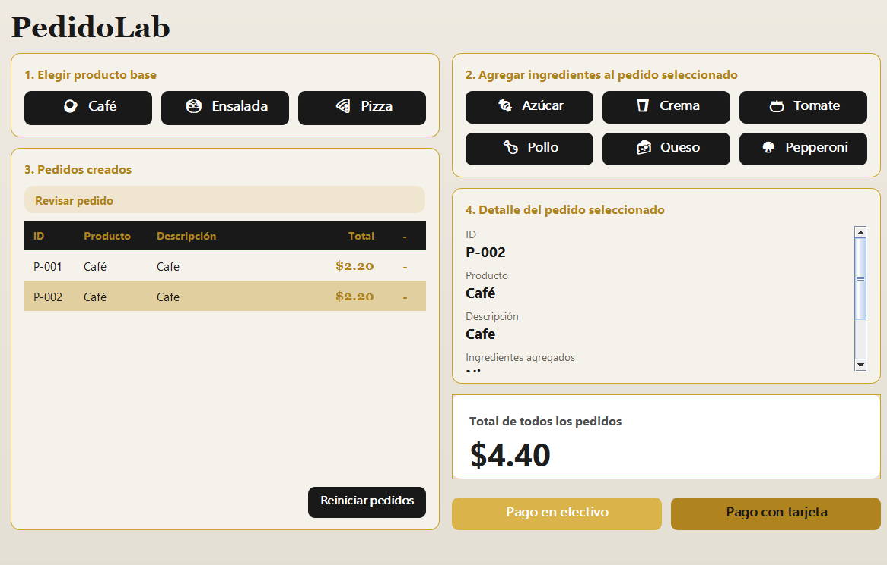
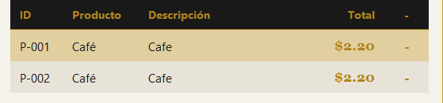
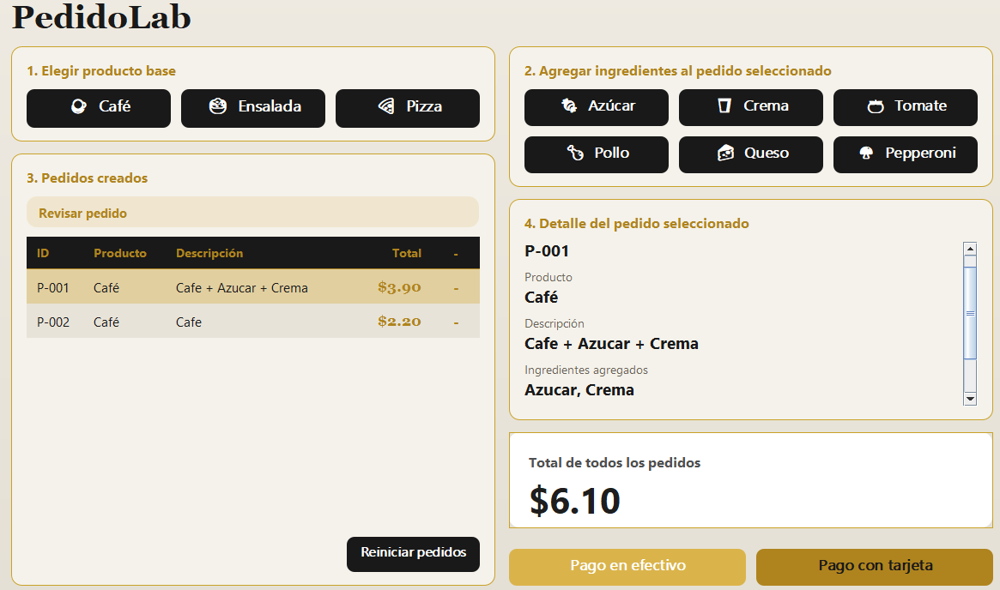
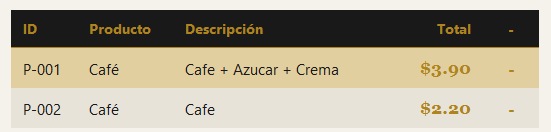
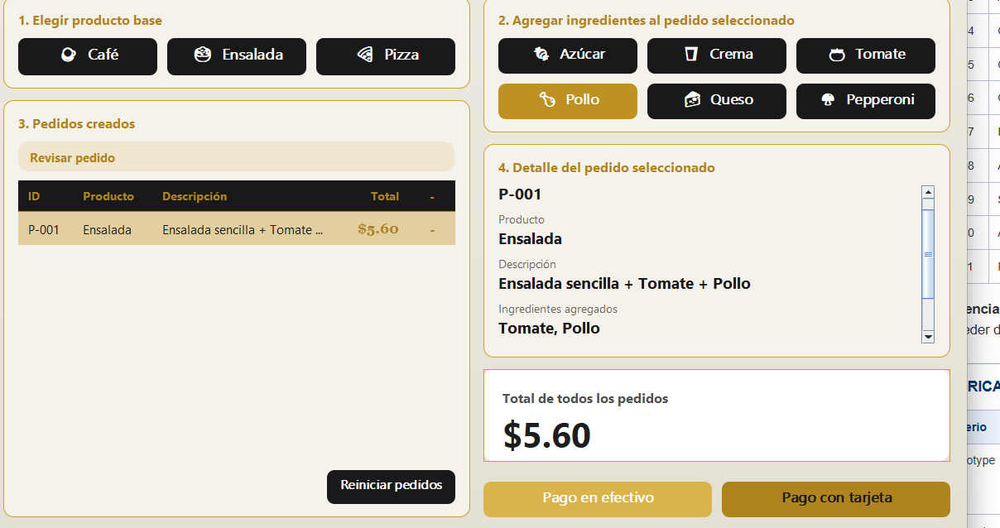
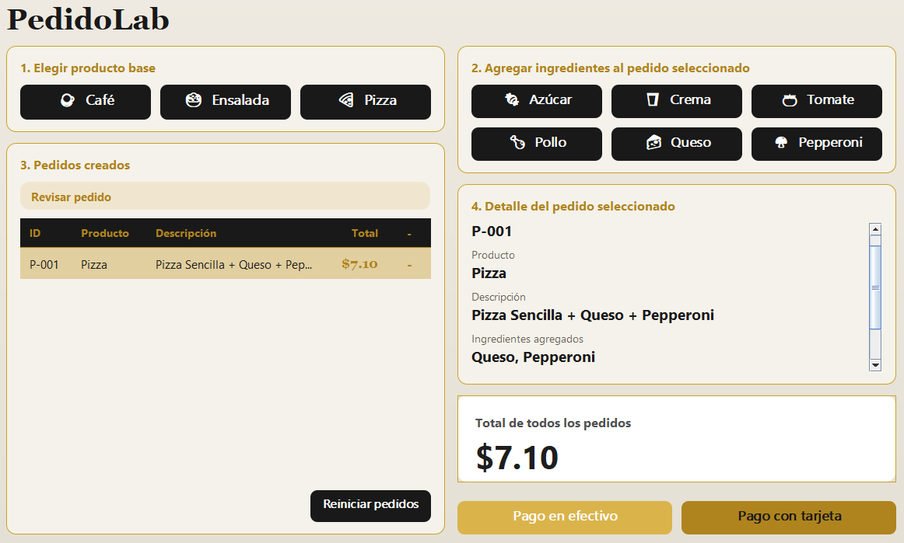
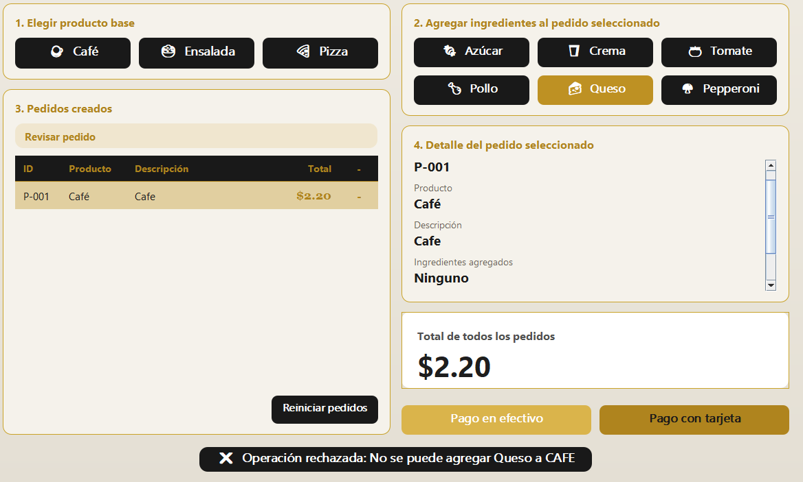
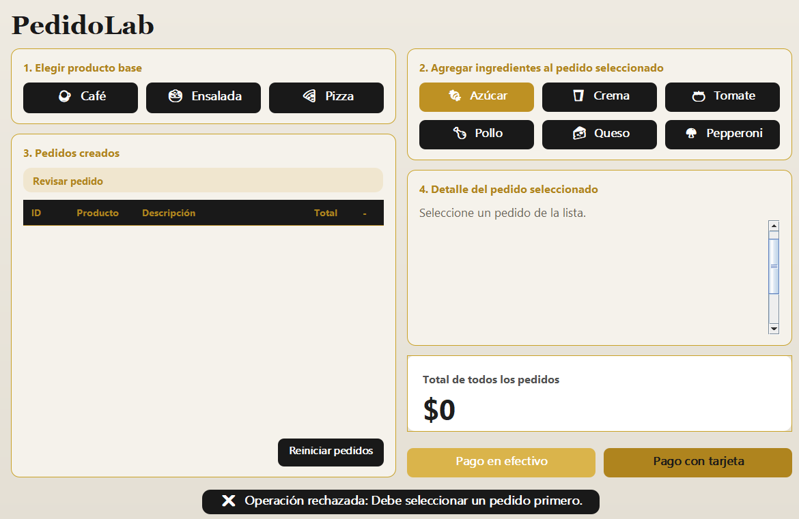
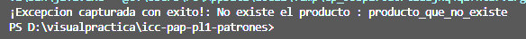
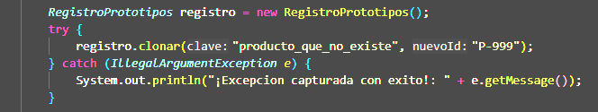

# Evidencias de Ejecución - PedidoLab (APP1)

## Casos de Aceptación

| **CA01** | Clonar Café dos veces | IDs diferentes; ambos empiezan en $2.20 | Se generaron IDs únicos (`P-001` y `P-002`) con precio base de $2.20 cada uno. | Prototype |

| **CA02** | Comparar clon y objeto del registro | Referencias distintas; el prototipo conserva su configuración | Se retornó una nueva instancia; el prototipo original mantuvo su estado en el registro. | Prototype |

| **CA03** | Al primer Café agregar Azúcar y Crema | Descripción incluye los dos ingredientes; total $3.90 | Descripción: "Café + Azúcar + Crema". Precio: $3.90. | Integración |

| **CA04** | Consultar el segundo Café sin ingredientes | Mantiene $2.20, sin ingredientes | El pedido `P-002` mantuvo precio de $2.20 sin ser alterado. | Prototype |

| **CA05** | Clonar Ensalada y agregar Tomate y Pollo | Total $5.60 | Descripción: "Ensalada sencilla + Tomate + Pollo". Precio: $5.60. | Integración |

| **CA06** | Clonar Pizza y agregar Queso y Pepperoni | Total $7.10 | Descripción: "Pizza Sencilla + Queso + Pepperoni". Precio: $7.10. | Integración |

| **CA07** | Intentar agregar Queso a Café | Operación rechazada; total y descripción no cambian | Se mostró notificación de rechazo. El estado del pedido se mantuvo intacto. | Validación |

| **CA08** | Agregar ingrediente sin pedido seleccionado | Mensaje claro y ningún cambio de estado | Se desplegó alerta indicando que se debe seleccionar un pedido primero. | Validación |

| **CA09** | Solicitar clon de clave inexistente | Fallo controlado; no se crea pedido | Prototype |

| **CA10** | Agregar dos veces Azúcar a un Café | Total $3.20 y dos aplicaciones del decorador | Descripción: "Café + Azúcar + Azúcar". Precio: $3.20 ($2.20 + $0.50 + $0.50). | Decorator |