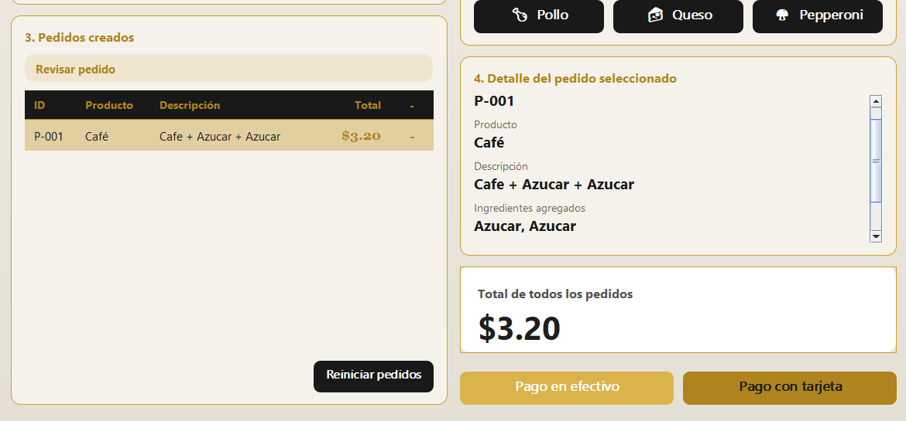
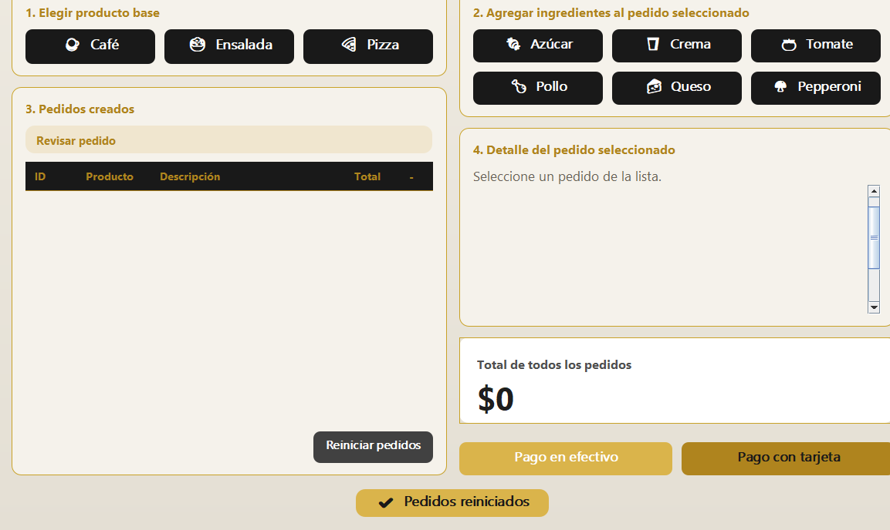
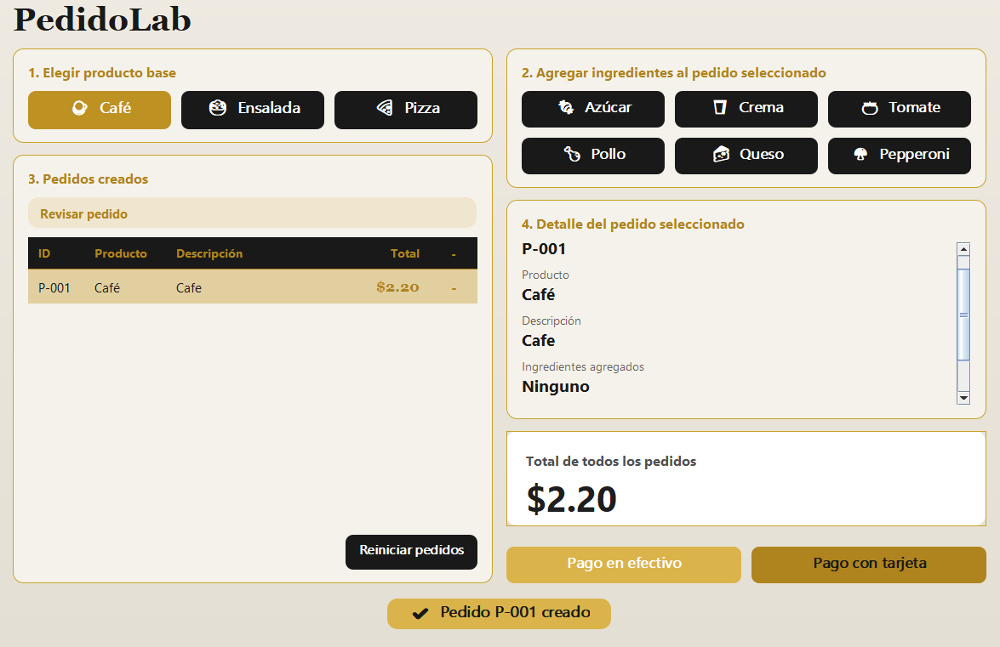

# Evidencias de Ejecución - PedidoLab (APP1)

## Casos de Aceptación

| **CA01** | Clonar Café dos veces | IDs diferentes; ambos empiezan en $2.20 | Se generaron IDs únicos (`P-001` y `P-002`) con precio base de $2.20 cada uno. | Prototype |

| **CA02** | Comparar clon y objeto del registro | Referencias distintas; el prototipo conserva su configuración | Se retornó una nueva instancia; el prototipo original mantuvo su estado en el registro. | Prototype |

| **CA03** | Al primer Café agregar Azúcar y Crema | Descripción incluye los dos ingredientes; total $3.90 | Descripción: "Café + Azúcar + Crema". Precio: $3.90. | Integración |

| **CA04** | Consultar el segundo Café sin ingredientes | Mantiene $2.20, sin ingredientes | El pedido `P-002` mantuvo precio de $2.20 sin ser alterado. | Prototype |

| **CA05** | Clonar Ensalada y agregar Tomate y Pollo | Total $5.60 | Descripción: "Ensalada sencilla + Tomate + Pollo". Precio: $5.60. | Integración |

| **CA06** | Clonar Pizza y agregar Queso y Pepperoni | Total $7.10 | Descripción: "Pizza Sencilla + Queso + Pepperoni". Precio: $7.10. | Integración |

| **CA07** | Intentar agregar Queso a Café | Operación rechazada; total y descripción no cambian | Se mostró notificación de rechazo. El estado del pedido se mantuvo intacto. | Validación |

| **CA08** | Agregar ingrediente sin pedido seleccionado | Mensaje claro y ningún cambio de estado | Se desplegó alerta indicando que se debe seleccionar un pedido primero. | Validación |

| **CA09** | Solicitar clon de clave inexistente | Fallo controlado; no se crea pedido | Prototype |

| **CA10** | Agregar dos veces Azúcar a un Café | Total $3.20 y dos aplicaciones del decorador | Descripción: "Café + Azúcar + Azúcar". Precio: $3.20 ($2.20 + $0.50 + $0.50). | Decorator |

| **CA11** | Reiniciar y volver a clonar Café | Nuevos pedidos parten nuevamente del valor base $2.20 | Se vació la lista de pedidos y el contador reinició en `P-001` con $2.20. | Prototype |

## Identificación de patrones
- **Prototype:**
  - **Clase y archivo:** RegistroPrototipos, en src/main/java/org/example/prototype/RegistroPrototipos.java.
  - **Dónde se registra el prototipo:** el metodo `registrar(clave, prototipo)` guarda el
    prototipo en un `HashMap` y se llama en el constructor de `ServicioPedidos`
    (servicio/ServicioPedidos.java), por ejemplo `registro.registrar("cafe", new Cafe("PROTO-CAFE"))`,
    y lo mismo para ensalada y pizza.
  - **Dónde se genera la copia:** el método clonar(clave, nuevoId) de `RegistroPrototipos`
    busca el prototipo y devuelve `prototipo.copiar(nuevoId)`. Cada producto implementa su
    propia copia; por ejemplo, Cafe.copiar(nuevoId) (prototype/Cafe.java) devuelve
    `new Cafe(nuevoId, this.descripcion, this.precioBase)`. Si la clave no existe, lanza
    `IllegalArgumentException` y no se crea ningún pedido.

- **Decorator:**
  - **Clase abstracta:** `DecoradorIngrediente` (decorator/DecoradorIngrediente.java), que
    implementa la interfaz `Pedido`.
  - Referencia al componente: el atributo `protected Pedido pedidoEnvuelto`.
  - Dos decoradores concretos: Azucar (+$0.50) y Crema (+$1.20), en
    decorator/Azucar.java y decorator/Crema.java. También existen Tomate, Pollo,
    Queso y Pepperoni.

- **Integración:** el método ServicioPedidos.agregarIngrediente(idPedido, ingrediente)
  (servicio/ServicioPedidos.java). El pedido se crea con `crearPedido(clave)`, que usa
  `registro.clonar(...)`. Cada llamada a `agregarIngrediente` valida la compatibilidad,
  envuelve el pedido con un decorador y lo reemplaza en la lista. Con dos llamadas el clon
  queda con dos decoradores anidados, por ejemplo `Crema(Azucar(Cafe))`, con total $3.90 y
  el mismo ID.

## Decisiones de diseño

1. **La lógica común de los ingredientes está en `DecoradorIngrediente`.**
   La clase abstracta guarda el pedido envuelto, el nombre y el costo del ingrediente.
   delega id() y tipo() al pedido envuelto y suma la descripción y el precio. Cada
   ingrediente concreto solo indica su nombre y su costo en el constructor.
   *Justificación:* asi no se repite codigo en seis clases, y si se cambia la forma de mostrar o de
   sumar, se cambia en un solo lugar. 

2. **`ServicioPedidos` concentra las reglas y es el único que usa el registro.
   La ventana solo captura eventos y muestra datos. Para crear un pedido llama a
   `crearPedido`, y para agregar un ingrediente llama a `agregarIngrediente`, que primero
   valida y despues crea el decorador.
   *Justificación:* la vista nunca crea productos con `new`, así que siempre se empieza con una 
   copia del prototipo. Si una operación es invalida (ingrediente incompatible, sin pedido
   seleccionado o clave inexistente), se lanza una excepción antes de crear algo y el pedido
   no cambia. 

## Conclusiones

1. El patrón Prototype me permitió crear varios pedidos del mismo producto sin tener que construirlos a mano en la interfaz. Los clones son independientes tienen ID
   distinto, no son la misma referencia que el prototipo y decorar uno no afecta a otro
2. El patrón Decorator permitió agregar ingredientes y repetirlos por composición, sin una
   clase por cada combinación. El precio sale de sumar los decoradores anidados.
3. Separar la validación y las reglas en `ServicioPedidos` hizo que los errores no modifiquen
   los pedidos.